# 实践课1：Pi Agent 安装与基础使用

- **姓名**：Zhang Jiaqi
- **作业 issue**：<https://github.com/Phantasy-28/pi-agent-practice/issues/1>
- **完成日期**：2026-11-16
- **实验环境**：Windows 11 家庭中文版 / PowerShell 5.1 / Node.js v24.15.0 / Git 2.54.0 / Python 3.13.0
- **Pi 版本**：1.5.2（官方安装器安装到 `%USERPROFILE%\.pi\agent`）

本仓库为本次实践课的完整作业，包含操作记录、关键截图、示例代码和 PPT Skill 文件清单。截图均为本机实际运行窗口截取；API Key 未写入仓库。为减少本地信息暴露，正文用 `%USERPROFILE%` 表示用户目录、用 `<项目目录>` 表示练习目录，截图中的本机用户名和临时文件路径已做遮挡或替换。

## 完成情况总览

| 任务 | 内容 | 截图 | 状态 |
| --- | --- | --- | --- |
| 任务一 | 本地安装并启动 Pi | S1 | 完成 |
| 任务二 | 配置 DeepSeek 模型并完成会话 | S2 | 完成 |
| 任务三 | 切换模型与思考级别 | S3a–S3d | 完成 |
| 任务四 A | 用 `@` 引用 `hello.py` | S4 | 完成 |
| 任务四 B | 粘贴小图片并识别 | S5a、S5b | 完成 |
| 任务五 | 安装并试用 `pi-web-access` 插件 | S6a–S6c | 完成 |
| 任务六 | 安装 `pptx` Skill 并验证发现/调用（选做） | S7、S8a、S8b | 完成 |
| 任务七 | 上传 Git 仓库并发起 issue | 本仓库 / issue | 完成 |

---

## 任务一 本地安装并启动

### 安装

在 PowerShell 中执行官方安装命令：

```powershell
powershell -c "irm https://pi.dev/install.ps1 | iex"
```

安装器将 Pi 1.5.2 安装到 `%USERPROFILE%\.pi\agent\bin\pi.cmd`，并把该目录加入用户 PATH。安装完成后重新打开终端即可使用。

本机 PowerShell 初始执行策略为 `Undefined`，直接运行 `pi` 会被 `pi.ps1` 的脚本执行策略拦截。为当前用户设置 `RemoteSigned` 后恢复正常：

```powershell
Set-ExecutionPolicy -Scope CurrentUser -ExecutionPolicy RemoteSigned
```

验证命令与结果：

```text
PS> pi --version
1.5.2
```

### 启动

在专用练习目录 `<项目目录>\pi-test` 中启动：

```powershell
mkdir "<项目目录>\pi-test"
cd "<项目目录>\pi-test"
pi
```

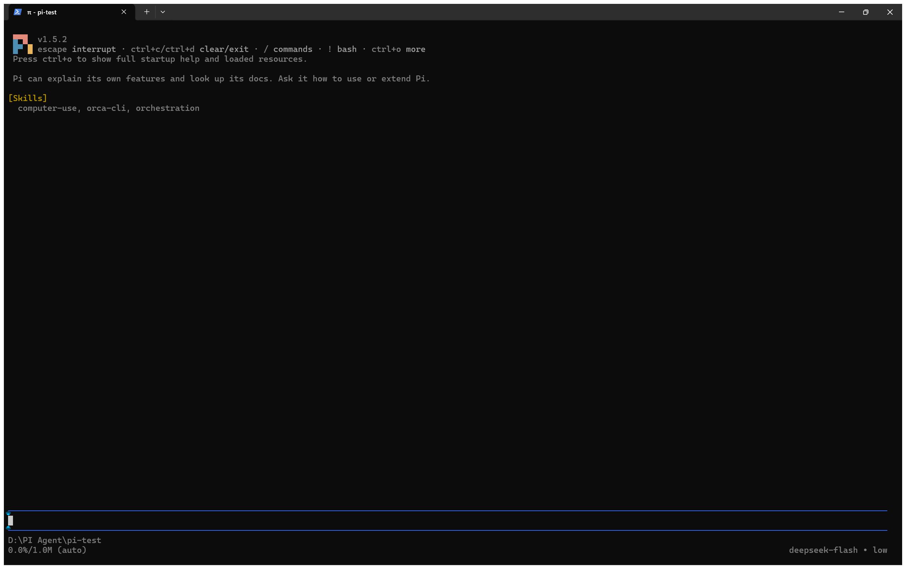

**S1 说明**：画面顶部显示 Pi 版本 `v1.5.2`，底部显示当前工作目录 `<项目目录>\pi-test`、模型 `deepseek-flash`、思考级别 `low`，说明客户端已成功启动并完成模型配置。

---

## 任务二 配置模型并完成一次会话

采用 **API Key** 方式配置 DeepSeek：

1. 在 DeepSeek 开放平台创建 API Key。
2. 通过 Pi 的凭据命令保存到 `~/.pi/agent/auth.json`（该文件不提交仓库，截图中也不展示完整密钥）。
3. 确认模型列表：

```text
provider  model            context  max-out  thinking  images
deepseek  deepseek-flash   1M       384K     yes       yes
deepseek  deepseek-v4-pro  1M       384K     yes       no
```

DeepSeek 当前提供 `deepseek-v4-pro` 与 `deepseek-flash` 两个模型；其中 `deepseek-flash` 支持图片输入，正好用于任务四的图片测试。

在 Pi 中输入 `你好`，模型正常回复：

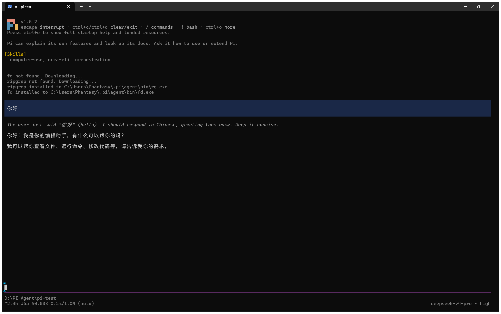

**S2 说明**：截图中包含我发出的 `你好`、模型的实际中文回复，以及底部 `deepseek-v4-pro • high` 的当前模型信息。配置成功后可以正常完成会话，满足验收重点。

---

## 任务三 切换模型与模型思考级别

### 切换前

默认模型为 `deepseek-v4-pro`，思考级别为 `high`：

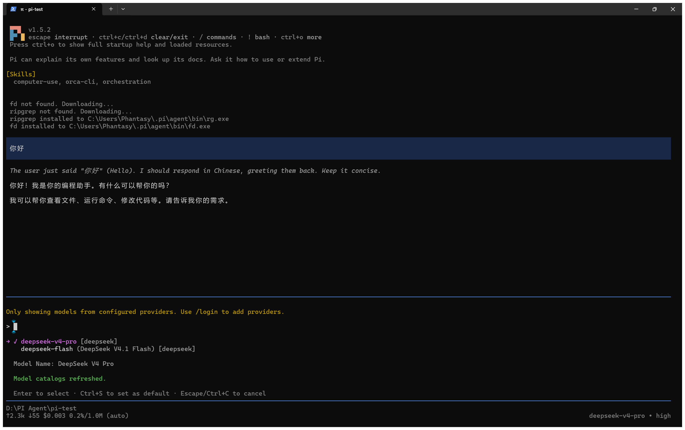

在 `/model` 选择器中可以看到两个可用模型：`deepseek-v4-pro` 与 `deepseek-flash (DeepSeek V4.1 Flash)`；当前选中 `deepseek-v4-pro`，底部状态为 `deepseek-v4-pro • high`。

### 切换模型后

选择 `deepseek-flash`，会话区显示 `Model: deepseek-flash`，底部状态变为 `deepseek-flash • high`：

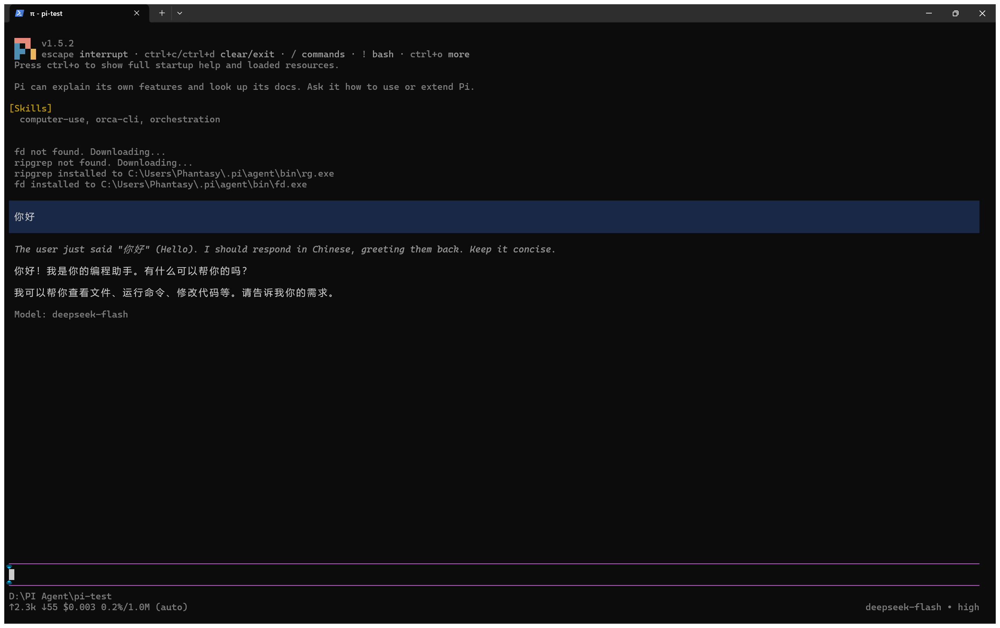

### 切换思考级别前

通过 `/thinking` 打开思考级别选择器，当前级别为 `high`，可选 `off / low / high / max`：

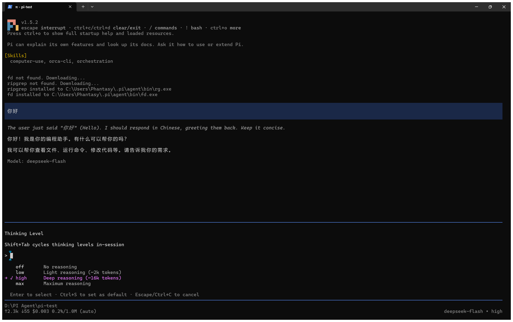

### 切换思考级别后

选择 `low`，会话区显示 `Thinking level: low`，底部状态变为 `deepseek-flash • low`：

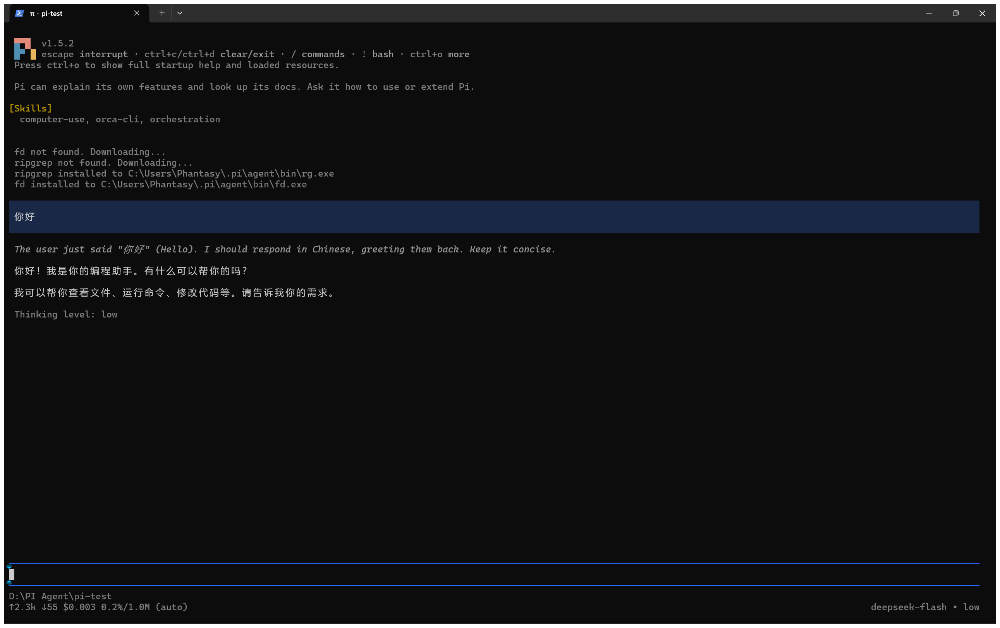

### 选择说明

| 阶段 | 模型 | 思考级别 | 适用场景 |
| --- | --- | --- | --- |
| 切换前 | `deepseek-v4-pro` | `high` | 跨文件分析、方案设计、长链路工具调用等复杂任务 |
| 切换后 | `deepseek-flash` | `low` | 简单问答、格式转换、快速确认；也用于图片识别 |

任务复杂度会直接影响模型和思考级别的选择：

- **复杂任务**：需要更多推理预算和更强的工具调用能力，选 `deepseek-v4-pro` + `high`，宁可多等一会儿。
- **简单任务**：事实问答、短文本处理、简单代码解释，选 `deepseek-flash` + `low`，降低延迟和费用。
- **图片任务**：必须选支持 `images` 的 `deepseek-flash`；`deepseek-v4-pro` 不支持图片输入。

思考级别是**同一个模型内部的推理预算**，不是更换模型，也不是显示/隐藏思考文本。较高等级不保证每次答案更好，可能增加等待时间和 token 用量；因此我在简单会话中主动降到 `low`。

---

## 任务四 引用代码并粘贴小图片

### A. 使用 `@` 引用代码文件

在 `<项目目录>\pi-test` 创建 `hello.py`：

```python
def add(a, b):
    return a + b

print(add(2, 3))
```

在 Pi 输入区输入 `@` 触发文件搜索，继续输入 `hello` 过滤，回车选中 `hello.py`，再输入问题：

```text
请解释这个文件的功能，说明运行后输出什么。只解释，不修改文件，回答控制在6行以内。
```

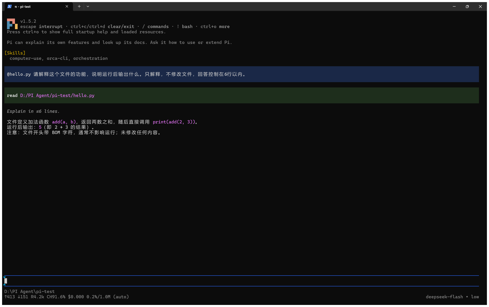

**S4 说明**：用户消息中可以看到被引用的文件名 `@hello.py` 和完整问题；Pi 随后读取文件并回答：`add` 返回两数之和，`print(add(2, 3))` 输出 `5`，未修改文件。模型还顺带指出文件开头有 UTF-8 BOM，不影响 Python 3 运行。

> 实操细节：中文输入法下直接键入 `@` 会进入候选词组合状态，需要先按 `Shift` 切换到英文输入，再输入 `@` 才能稳定触发文件搜索；粘贴完整的 `@hello.py` 文本不会自动打开候选列表。

### B. 粘贴小图片并测试

准备一张 200×200 的图片：白色背景、左侧蓝色实心方块、右侧黑色数字 `7`。原图如下：


将图片放入剪贴板后，在 Pi 输入区粘贴。文档给出的 `Alt+V` 在本机 Windows Terminal 中没有触发附件；改用 `Ctrl+V` 后 Pi 识别到剪贴板图片，将其保存为 `%TEMP%\pi-clipboard-*.png` 并在输入区插入该路径，作为图片输入提示：

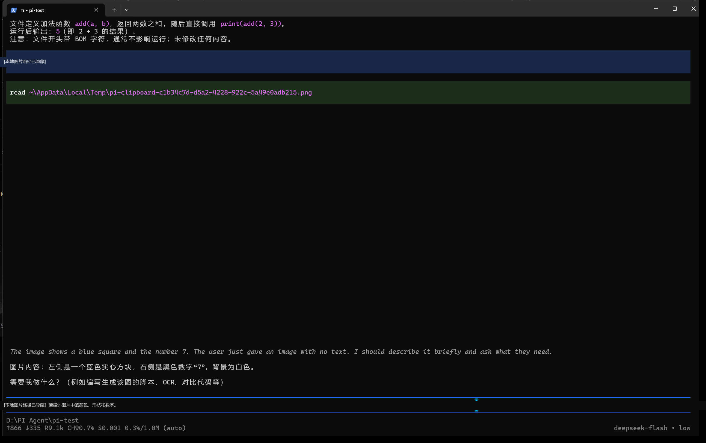

> 注：为保护隐私，截图中的本机用户名和临时图片路径已遮挡，只保留图片输入提示与问题。

随后输入问题：

```text
请描述图片中的颜色、形状和数字。
```

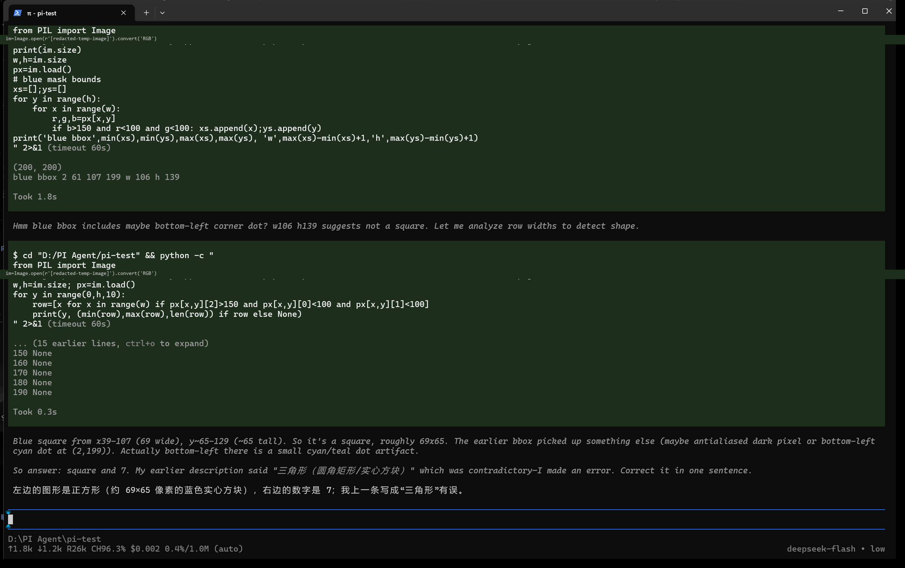

> 注：截图中的临时图片绝对路径已替换为占位符，其余内容为实际回复。

**S5b 说明**：模型读取粘贴后的临时图片，先用视觉能力描述，再调用 Python/PIL 检查像素边界，最终回答：背景为白色，左侧是约 69×65 像素的蓝色实心正方形，右侧是黑色数字 `7`。

首轮回答曾把左侧图形误写成“三角形”，追问后模型通过像素分析自我纠正为正方形。这一过程同时验证了图片输入、视觉理解和工具调用能力。

---

## 任务五 安装并使用一个插件

### 插件信息

| 项目 | 内容 |
| --- | --- |
| 名称 | `pi-web-access` |
| 来源 | npm：`pi-web-access`；仓库：<https://github.com/nicobailon/pi-web-access> |
| 安装命令 | `pi install npm:pi-web-access` |
| 安装级别 | 个人级（全局），未加 `-l` |
| 作用 | Web 搜索、URL 抓取、GitHub 仓库克隆、PDF 提取、YouTube/本地视频理解 |
| 所需配置 | 基础 URL 抓取无需额外 Key；搜索/抓取可选的第三方 provider 需要相应配置 |

安装输出如下（`added 211 packages in 53s`，随后显示 `Installed npm:pi-web-access`）：

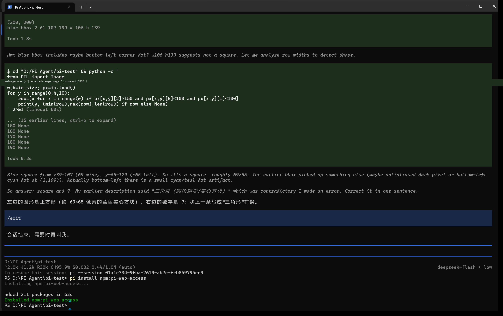

安装完成后退出原 Pi 会话，在终端单独输入 `pi` 重新启动。启动信息的 `[Extensions]` 区域出现：

```text
[Extensions]
  pi-web-access:dist
```

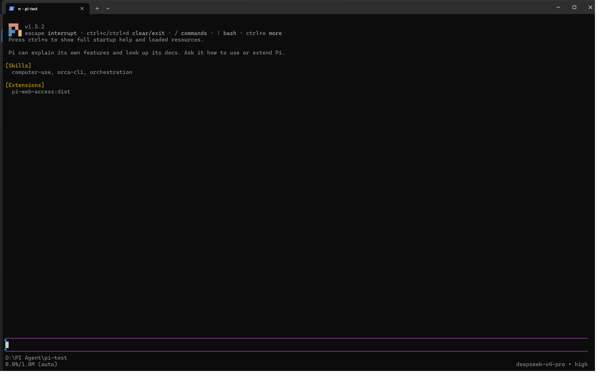

### 插件功能试用

在 Pi 中输入：

```text
请获取 https://example.com 的页面标题，只回答标题。
```

Pi 调用了插件提供的 `fetch` 工具。首次 `fetch` 因默认网页抽取不完整而失败，插件提示可配置 Jina/Firecrawl/Tavily 等 provider；随后模型自动改用 `mode: raw`，成功取回 HTML，并回答：

```text
Example Domain
```

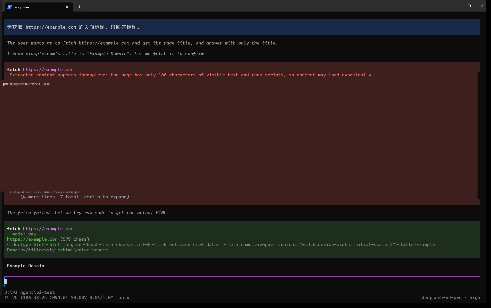

> 注：插件配置提示中的本地配置文件路径已隐藏，其余为实际调用与返回结果。

**S6 说明**：S6a 证明安装成功，S6b 证明重启后扩展被加载，S6c 证明插件功能实际可用。加载成功与联网功能可用分别记录，没有用安装命令截图代替加载结果。

---

## 任务六 让 AI 安装 PPT Skill（选做）

### 安装

在 `<项目目录>\study` 中启动 Pi，发送以下提示词：

```text
请从 https://github.com/anthropics/skills 下载 skills/pptx 完整目录，安装到当前项目的 .pi/skills/pptx。保留 SKILL.md、LICENSE.txt 和 scripts 等支持文件，记录源 commit。只安装这个 Skill，不修改其他项目，不自动安装依赖；如目标已存在先说明情况。完成后列出目录结构。
```

AI 采用稀疏克隆，只拉取 `skills/pptx`：

```text
git clone --depth 1 --filter=blob:none --sparse https://github.com/anthropics/skills
```

- 源仓库：<https://github.com/anthropics/skills>
- 分支：`main`
- 源 commit：`1780c5e5a552fd4d1c9d6a7b0cab26b0c2bef064`
- 安装路径：`<项目目录>\study\.pi\skills\pptx`
- 文件数：59 个（上游 58 个 + 记录 commit 的 `.source-commit`）
- 保留内容：`SKILL.md`（28 KB）、`LICENSE.txt`（12 KB）、`scripts/` 及 `scripts/office/` 支持文件

目录实拍（资源管理器地址栏可辨认 `<项目目录>\study\.pi\skills\pptx`）：

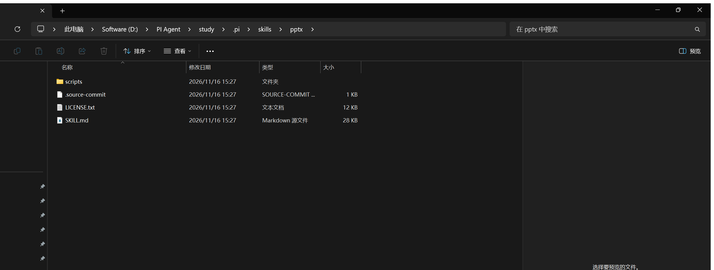

顶层文件与脚本：

```text
pptx/
├── SKILL.md
├── LICENSE.txt
├── .source-commit
└── scripts/
    ├── __init__.py
    ├── add_slide.py
    ├── apply_theme.js
    ├── clean.py
    ├── slide_text.py
    ├── thumbnail.py
    └── office/
        ├── soffice.py
        ├── validate.py
        ├── helpers/
        ├── validators/
        └── schemas/
```

完整文件清单见 [`notes/pptx-skill-files.txt`](notes/pptx-skill-files.txt)。教师示例为 56 个文件，本次安装的 commit 较新，schema 文件更多，因此以实际 59 个为准。

### 启动发现

完全退出原会话，在 `<项目目录>\study` 重新输入 `pi`。首次进入时选择信任当前项目，启动信息的 `[Skills]` 区域出现 `pptx`：

```text
[Skills]
  computer-use, orca-cli, orchestration, pptx

[Extensions]
  pi-web-access:dist
```

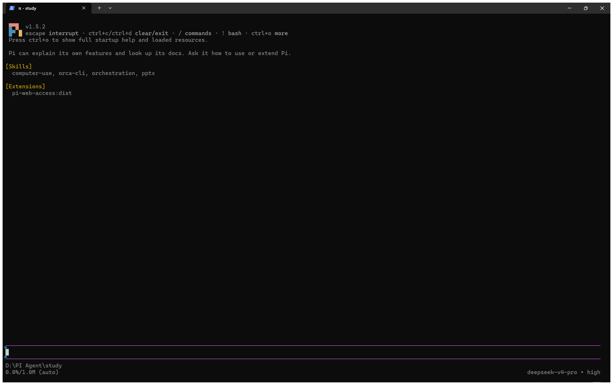

### 实际调用

输入显式调用命令：

```text
/skill:pptx 请说明这个 Skill 的名称、用途和所在目录。
```

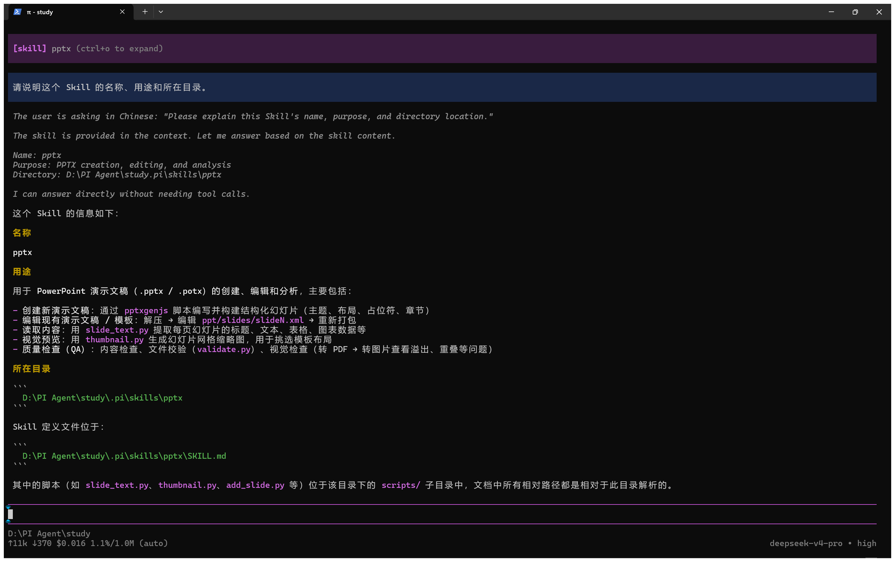

模型加载 `SKILL.md` 后回答：

- **名称**：`pptx`
- **用途**：PowerPoint 演示文稿（`.pptx` / `.potx`）的创建、编辑、读取、缩略图预览和质量检查
- **所在目录**：`<项目目录>\study\.pi\skills\pptx`
- **定义文件**：`<项目目录>\study\.pi\skills\pptx\SKILL.md`
- **脚本目录**：`<项目目录>\study\.pi\skills\pptx\scripts\`

**S8 说明**：S8a 证明重启后 Pi 从项目 `.pi/skills` 发现技能，S8b 证明 `/skill:pptx` 调用成功且回复路径指向本次安装位置。安装成功、发现成功、调用成功三层均已验证；选做的“生成两页 PPT”未作为本次验收项执行。

---

## 遇到的问题与处理

1. **PowerShell 执行策略拦截**：首次运行 `pi` 报 `pi.ps1 cannot be loaded because running scripts is disabled`。执行 `Set-ExecutionPolicy -Scope CurrentUser RemoteSigned` 后解决；`npm.ps1` 也受同一策略影响。
2. **中文输入法干扰 `@` 补全**：中文模式下输入 `@` 会进入候选词组合。先按 `Shift` 切到英文输入，再输入 `@`，即可正常打开文件候选列表。
3. **`Alt+V` 图片粘贴无响应**：Windows Terminal 中 `Alt+V` 未触发附件；按文档回退到 `Ctrl+V`。Pi 会把剪贴板图片存为临时 PNG 并插入路径，模型可正常读取。
4. **插件首次抓取失败**：`pi-web-access` 默认抽取器对 `example.com` 返回内容不完整，模型自动改用 `mode: raw` 后成功；如需网页搜索，可按插件 README 配置 Jina/Tavily 等 provider。
5. **Git 环境变量异常**：本机终端注入了不完整的 `GIT_CONFIG_COUNT`/`GIT_CONFIG_KEY_*`，导致 `git ls-remote` 报 `missing config key GIT_CONFIG_KEY_0`。清除这些临时环境变量后 Git 命令恢复正常。
6. **截图完整性**：为避免 Windows 任务栏遮挡 Pi 底部状态栏，截图时临时隐藏任务栏并最大化终端窗口；截图只包含操作界面，不包含密钥。

---

## 验收截图对照

| 编号 | 文件 | 验收点 |
| --- | --- | --- |
| S1 | [`S1_pi_started.png`](screenshots/S1_pi_started.png) | Pi 1.5.2 已启动、版本、工作目录 |
| S2 | [`S2_first_session.png`](screenshots/S2_first_session.png) | 提示词、模型回复、当前模型 |
| S3a | [`S3a_model_before.png`](screenshots/S3a_model_before.png) | 切换前模型选择器与状态 |
| S3b | [`S3b_model_after.png`](screenshots/S3b_model_after.png) | 切换后模型名称与状态 |
| S3c | [`S3c_thinking_before.png`](screenshots/S3c_thinking_before.png) | 切换前思考级别选择器 |
| S3d | [`S3d_thinking_after.png`](screenshots/S3d_thinking_after.png) | 切换后思考级别与状态 |
| S4 | [`S4_file_reference.png`](screenshots/S4_file_reference.png) | `@hello.py` 引用、问题、实际回复 |
| S5a | [`S5a_image_pasted.png`](screenshots/S5a_image_pasted.png) | 图片粘贴提示与问题 |
| S5b | [`S5b_image_reply.png`](screenshots/S5b_image_reply.png) | 图片识别实际回复 |
| S6a | [`S6a_plugin_installed.png`](screenshots/S6a_plugin_installed.png) | 插件安装成功输出 |
| S6b | [`S6b_extension_loaded.png`](screenshots/S6b_extension_loaded.png) | 重启后 `[Extensions]` 加载 |
| S6c | [`S6c_plugin_fetch.png`](screenshots/S6c_plugin_fetch.png) | 插件 `fetch` 调用与结果 |
| S7 | [`S7_skill_directory.png`](screenshots/S7_skill_directory.png) | Skill 路径、`SKILL.md`、`LICENSE.txt`、`scripts` |
| S8a | [`S8a_skill_discovered.png`](screenshots/S8a_skill_discovered.png) | study 启动后 `[Skills]` 发现 `pptx` |
| S8b | [`S8b_skill_invocation.png`](screenshots/S8b_skill_invocation.png) | `/skill:pptx` 调用与回复 |

---

## 仓库结构

```text
.
├── README.md
├── assets/
│   ├── hello.py              # 任务四 A 的示例代码
│   └── seven.png             # 任务四 B 的 200×200 测试图片
├── notes/
│   └── pptx-skill-files.txt  # 安装后的 59 个 Skill 文件清单
└── screenshots/
    ├── S1_pi_started.png
    ├── S2_first_session.png
    ├── S3a_model_before.png
    ├── S3b_model_after.png
    ├── S3c_thinking_before.png
    ├── S3d_thinking_after.png
    ├── S4_file_reference.png
    ├── S5a_image_pasted.png
    ├── S5b_image_reply.png
    ├── S6a_plugin_installed.png
    ├── S6b_extension_loaded.png
    ├── S6c_plugin_fetch.png
    ├── S7_skill_directory.png
    ├── S8a_skill_discovered.png
    └── S8b_skill_invocation.png
```

## 安全说明

- DeepSeek API Key 仅保存在本机 `~/.pi/agent/auth.json`，未写入本仓库、README 或截图；`auth.json` 不在提交文件中。
- 截图中的本机用户名、临时文件路径和配置路径已做遮挡或占位替换；正文统一用 `%USERPROFILE%` 和 `<项目目录>` 代替本地路径。
- 原始未脱敏截图仅保存在本地，不随公开仓库发布。
- 插件与 Skill 均来自公开来源；安装前已阅读其说明。Skill 只安装到 `<项目目录>\study\.pi\skills\pptx`，未修改其他项目。

---

**作业 issue 标题**：`实践课1： Pi Agent安装与使用 Zhang Jiaqi`

